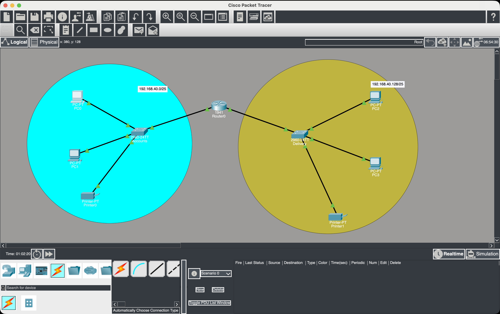
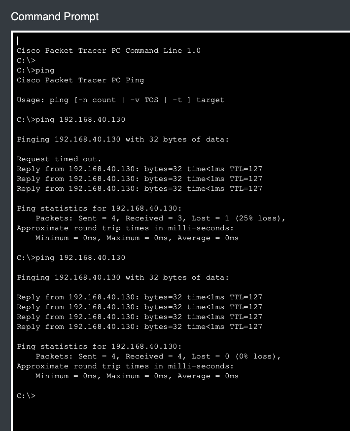

# Department Network Design — Cisco Packet Tracer

A beginner networking project that connects the **Accounts** and **Delivery** departments using IPv4 subnetting, Ethernet switches, and a router. The topology is built and tested in Cisco Packet Tracer, with a focus on understanding how separate departmental subnets communicate through a Layer 3 device.

## Problem Statement

Design a network in Cisco Packet Tracer that connects the Accounts and Delivery departments using the network address `192.168.40.0`. Each department must contain at least two PCs. Select an appropriate number of switches and routers, assign suitable IP addresses, subnet masks, and default gateways to the network interfaces, and connect the devices using appropriate cables. Verify that PCs in the two departments can communicate, including successful ping tests between departments.

## Project Objectives

- Divide the provided IPv4 network into separate subnets for the two departments.
- Build a departmental network topology using PCs, switches, and a router.
- Configure IP addressing, subnet masks, and default gateways.
- Connect end devices and network equipment using appropriate links.
- Verify interdepartmental connectivity with the `ping` command.

## Topology

The network contains two departmental LANs connected through a Cisco 1941 router. Each LAN has a Cisco 2960 switch, two PCs, and a printer.



### Devices Used

| Device | Quantity | Purpose |
|---|---:|---|
| Cisco 1941 router | 1 | Routes traffic between the two departmental subnets |
| Cisco 2960 switches | 2 | Connect each department's local devices |
| PCs | 4 | Endpoints used to test network connectivity |
| Printers | 2 | Networked peripheral devices, one per department |

## IPv4 Subnetting

### Given Network

- **Network address:** `192.168.40.0`
- **Original network prefix:** `/24`
- **Original subnet mask:** `255.255.255.0`
- **Required subnets:** 2 — one for Accounts and one for Delivery

### Subnet Calculation

The original `/24` network has 8 host bits in the final octet. To create at least two subnets, borrow one host bit for the network portion:

- Number of subnets created: \(2^1 = 2\)
- New prefix length: `/25`
- New subnet mask: `255.255.255.128`
- Block size in the final octet: `256 - 128 = 128`
- Addresses per subnet: 128
- Usable host addresses per subnet: 126 (excluding the network and broadcast addresses)

The `/25` mask splits the original `192.168.40.0/24` network into two equal-sized subnets.

### Subnet Addressing Table

| Parameter | Accounts Department | Delivery Department |
|---|---|---|
| Network ID | `192.168.40.0/25` | `192.168.40.128/25` |
| Subnet mask | `255.255.255.128` | `255.255.255.128` |
| First usable address | `192.168.40.1` | `192.168.40.129` |
| Last usable address | `192.168.40.126` | `192.168.40.254` |
| Broadcast address | `192.168.40.127` | `192.168.40.255` |
| Usable host range | `192.168.40.1–192.168.40.126` | `192.168.40.129–192.168.40.254` |

> **Addressing note:** The table shows the available ranges for each subnet, not a complete device-by-device IP assignment. Configure each PC, printer, and router interface with a unique usable address in its department's subnet. Set each end device's default gateway to the IP address of the router interface serving that subnet. Do not assign a subnet's network ID or broadcast address to a device.

## Implementation Overview

1. **Create the topology:** Place one Cisco 1941 router, two Cisco 2960 switches, four PCs, and two printers in Cisco Packet Tracer.
2. **Build the departmental LANs:** Connect the two PCs and printer in each department to that department's switch.
3. **Connect the router:** Connect each departmental switch to a separate router interface using an appropriate Ethernet cable.
4. **Configure IPv4 addressing:** Assign unique addresses and the `/25` subnet mask to end devices and router interfaces.
5. **Configure default gateways:** Set each end device's gateway to the router interface address in its own subnet.
6. **Verify connectivity:** Use `ping` from a PC in one department to a reachable host in the other department.

The screenshots document the topology and a successful ping test. Exact interface addresses and command-line configuration are not listed here because a complete device-by-device addressing table was not provided.

## Connectivity Verification

The test screenshot shows PC0 pinging `192.168.40.130`, an address in the Delivery subnet (`192.168.40.128/25`).



The first ping attempt shows **3 replies out of 4 packets** (25% packet loss). A second ping test shows **4 replies out of 4 packets** (0% packet loss), demonstrating successful IP connectivity to the destination during the second test.

The initial missed reply can occur while a device resolves the destination's Layer 2 address using ARP. The screenshot is consistent with that behavior, although it does not independently prove the cause of the first timeout.

## Skills Practiced

- IPv4 addressing and subnetting
- CIDR notation and subnet masks
- Network topology design in Cisco Packet Tracer
- Basic router and switch connectivity
- Default gateway configuration
- Troubleshooting with `ping` and interpreting packet-loss statistics

## Tools

- **Cisco Packet Tracer**
- **IPv4 networking**
- **ICMP ping testing**

## Repository Contents

```text
.
├── README.md
└── images/
    ├── network-topology.jpg
    └── ping-verification.jpg
```

## How to Open the Project

Open the Cisco Packet Tracer `.pkt` file associated with this project in Cisco Packet Tracer. The screenshots in this repository provide visual documentation of the topology and connectivity test.

> **For the repository:** Add your actual `.pkt` file alongside this README if you want visitors to be able to open and inspect the simulated network. The screenshots alone do not contain the editable Packet Tracer project.

## Learning Outcome

This project demonstrates how to split a `/24` IPv4 network into two `/25` departmental networks and use a router to enable communication between them. It also provides practice with basic network construction, host addressing, default gateways, and connectivity verification.
